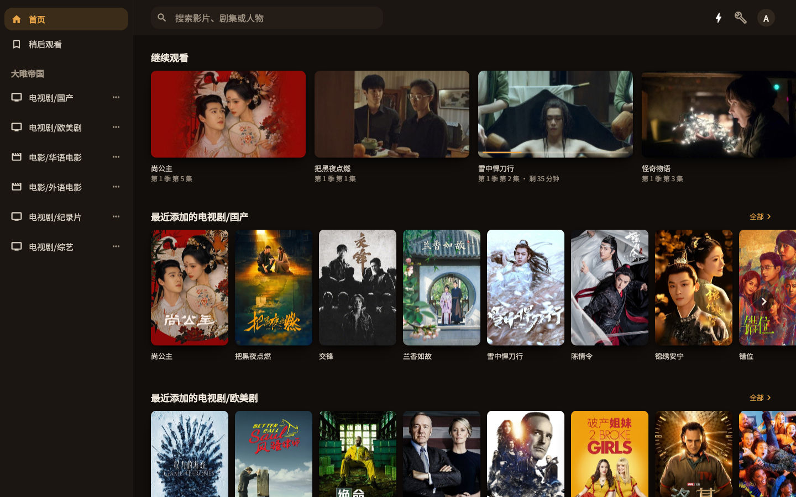
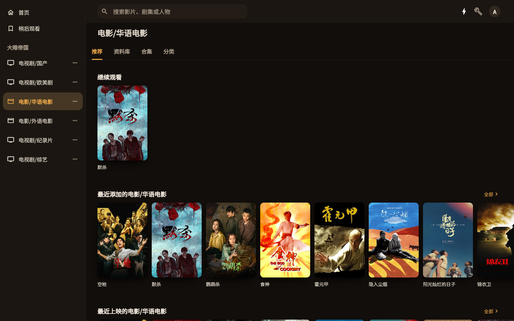
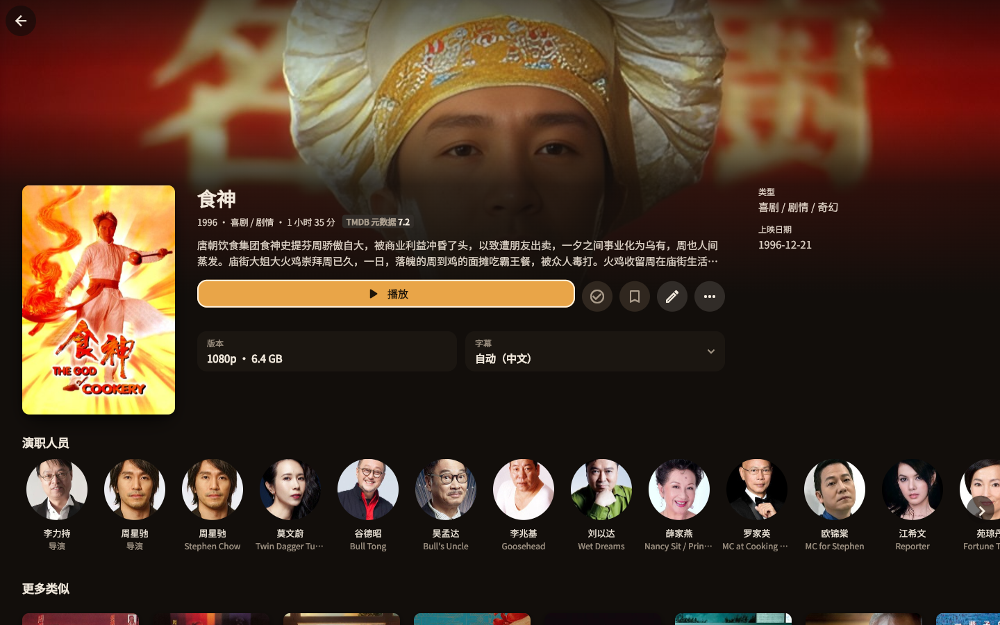
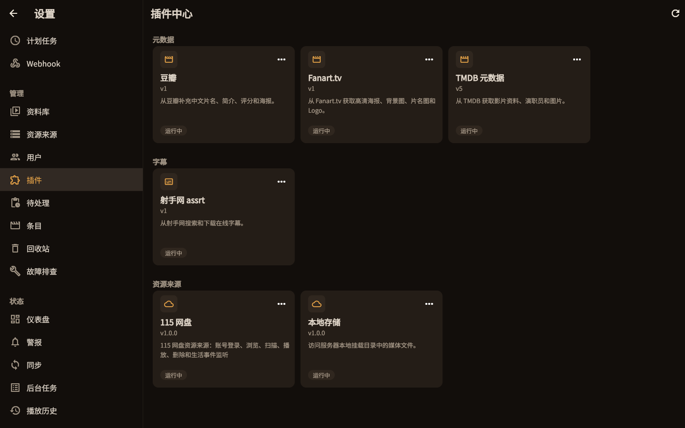
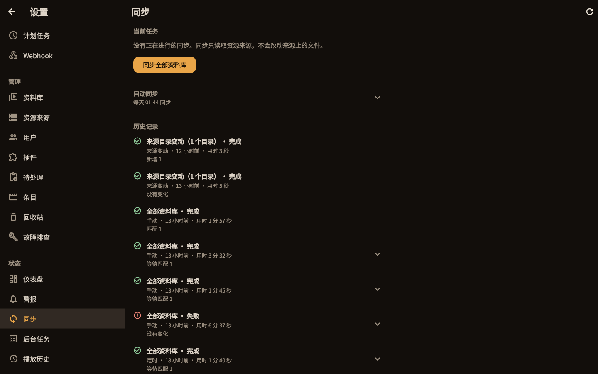
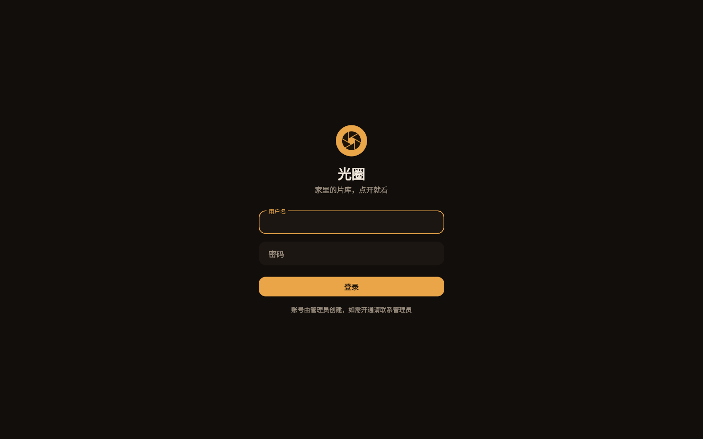

# 光圈 / Iris

[](https://github.com/huhengbo/iris/actions/workflows/ci.yml)
[](https://github.com/huhengbo/iris/actions/workflows/release.yml)

自托管的影视库：把分散在网盘或本地目录里的电影和剧集整理成影视墙，给自己和家人朋友在手机、电视和浏览器上看。

- **资源来源插件化**：片源通过 `resource.source` 插件接入，内置 115 网盘和本地存储两种，核心不依赖任何一个网盘。插件在独立子进程里运行，可以单独开发、安装和移除。
- **元数据本地化**：文件名识别后匹配 TMDB 等元数据插件，简介、海报、剧照都存在本地，浏览时不访问片源和元数据站。
- **视频不经过服务器**：播放时签发 24 小时有效的播放令牌，由来源插件解析播放地址——网盘来源 302 跳转到直链，本地来源直接返回文件；不转码。
- **不挂载、不生成 STRM**：同步时读取来源的目录快照，只补全有变化的部分；扫描本身不修改来源。
- **多端**：
  - Android App 有内置播放器（mpv 内核，记录进度），也能调起其他播放器，或通过 DLNA 投到电视自带的「投屏」；
  - Android TV 用同一个 APK，支持遥控器操作；
  - 网页端可以浏览，并调起 Infuse、VLC 等本机播放器，或复制播放链接；
  - 提供 Emby 兼容接口，Infuse 等第三方客户端可以直接连接。
- **WebDAV**：用同一个账号在 Infuse 等播放器里以 WebDAV 方式浏览片库，只读，可见范围同样按资料库分配。
- **多用户**：账号由管理员创建，普通用户只能看到分配给自己的资料库。
- **插件**：资源来源、元数据（TMDB、豆瓣）、图片（Fanart.tv）、在线字幕（assrt）都是插件，内置在 `plugins/`。

> [!IMPORTANT]
> 本项目只提供影视库管理和播放工具，不提供、托管或分发任何媒体内容。请确认你的使用方式符合所在地区法律法规，以及网盘等第三方服务的使用条款。

## 技术栈

| 层 | 技术 |
|---|---|
| 后端 | Python 3.13、FastAPI、Pydantic、SQLite、httpx |
| 客户端 | Flutter（Android、Android TV、Web 共用）、media_kit（mpv 内核） |
| 插件 | 进程外子进程 + JSON-RPC，公共 SDK `iris-plugin-sdk` |
| 质量 | pytest、ruff、mypy（strict）、dart analyze、flutter test |
| 部署 | Docker Buildx、Docker Compose、GHCR、amd64 + arm64 |

## 截图

Web 客户端截图（Android App 和 TV 共用同一套界面代码）。

| | |
|---|---|
| <br>首页：继续观看和各资料库最近添加 | <br>资料库：推荐、资料库、合集、分类 |
| <br>详情：版本、字幕、演职员 | <br>插件中心：元数据、字幕、资源来源 |
| <br>同步：任务历史和自动同步 | <br>登录 |

截图里的影视海报、剧照和人物图片来自 TMDB 等元数据源，版权归原权利人所有，仅用于展示界面。

本项目使用 TMDB 的 API，但未获得 TMDB 的认可或认证（This product uses the TMDB API but is not endorsed or certified by TMDB）。

## 架构

```
 手机 / 电视 / 浏览器 ──HTTP──▶ 光圈服务（FastAPI + SQLite，同时托管 Web 客户端）
        │                          │  JSON-RPC（stdio）
        │                          ▼
        │                    插件进程：资源来源（115 / 本地存储 …）、元数据、字幕、图片
        │                          │
        │                          ▼
        │                    网盘 / 本地目录      TMDB 等（刮削，只在同步时访问）
        │
        └──── 播放器请求 /play/… ──▶ 302 ──▶ 来源的直链（网盘来源，视频流直连网盘）
                                  └─▶ 服务端返回文件（本地来源）
```

部署形态是一个 Docker 镜像加一个数据卷。客户端和服务端只通过 `/api` 交互，App 可以添加和切换多个服务器。

## 目录

| 路径 | 内容 |
|---|---|
| `backend/` | Python 3.13 后端：`app/` 源码（`api/` 路由，管理接口在 `api/admin/`；`sync/` 同步；`library/` 识别、刮削与浏览；`playback/` 播放签发与跳转；`auth/` 用户与会话；`ops/` 备份、维护、告警和 webhook；`plugins/` 插件运行时：发现、RPC、supervisor 和 provider 代理），`tests/` 测试 |
| `packages/iris-plugin-sdk/` | 进程外插件公共 SDK：协议类型、manifest、codec、运行时和资源契约测试 |
| `plugins/` | 内置插件包（115 网盘、本地存储、TMDB、豆瓣、Fanart.tv、assrt），每个插件有自己的 `pyproject.toml`、`plugin.json` 和 `.venv` |
| `client/` | Flutter 客户端（Android、Android TV、Web 共用），`lib/features/` 按功能划分 |
| `docs/adr/` | 架构决策记录 |
| `docs/spec/` | 界面设计的差异清单和分批记录 |
| `docs/deploy.md` | 部署、反向代理、备份、升级 |
| `CONTEXT.md` | 术语表，代码和文档里的名词以它为准 |
| `DESIGN.md` | 界面设计规范（颜色、排版、组件、动效、TV 适配） |
| `scripts/` | `install.sh` 一键部署、`check.sh` 全部检查、`build-image.sh` 多架构镜像、`sync-plugins.sh` 同步插件虚拟环境、`update-openapi.py` 更新接口文档 |

## 部署

需要 Docker 和 Docker Compose v2。一键部署（生成配置和随机密钥、拉取镜像、启动并等待就绪）：

```sh
curl -fsSL https://raw.githubusercontent.com/huhengbo/iris/main/scripts/install.sh | bash
```

默认部署到当前目录下的 `iris/`，管理员密码随机生成并在结束时显示一次。升级用 `scripts/install.sh upgrade`。可用的环境变量见脚本开头。

详见 [`docs/deploy.md`](docs/deploy.md)。手动部署的简要步骤：

1. 复制 `docker-compose.yml` 和 `.env.example`（改名为 `.env`），填写 `APP_SECRET_KEY`、`APP_ADMIN_PASSWORD` 等。
2. 建好数据目录：`mkdir data && sudo chown 1000:1000 data`。
3. `docker compose up -d --build`，用 `curl http://127.0.0.1:8080/api/health` 确认启动。
4. 在前面配好 HTTPS 反向代理。
5. 用管理员登录，在管理后台依次完成：在插件页配置资源来源（如 115 扫码登录，本地存储则只需挂载目录）和元数据插件、填写对外访问地址、添加资料库、同步。

## 镜像与安装包

镜像发布在 `ghcr.io/huhengbo/iris`，支持 `linux/amd64` 和 `linux/arm64`：

| 场景 | 标签 |
|---|---|
| 正式版本 | `0.1.0` |
| 当前小版本的最新补丁 | `0.1` |
| 最新正式版本 | `latest` |

Android / Android TV 的 APK 在 [Releases](https://github.com/huhengbo/iris/releases) 页下载，按设备架构选 `arm64-v8a`（多数手机和电视盒子）、`armeabi-v7a`（老设备）或 `x86_64`（模拟器）。APK 使用固定的 release 签名，之后的版本可以直接覆盖安装。

## 本地开发

需要：Python 3.13 和 [uv](https://docs.astral.sh/uv/)、Flutter 3.47（Dart 3.13）、Android SDK（构建 APK 时）。

### 后端

```sh
cp .env.example .env        # 填写 APP_SECRET_KEY（至少 32 个字符）和 APP_ADMIN_PASSWORD
cd backend
uv sync
set -a && . ../.env && set +a
APP_DATA_DIR=../data APP_STATIC_DIR=../client/build/web \
  uv run uvicorn app.main:create_app_from_env --factory --host 127.0.0.1 --port 8080
```

- `APP_DATA_DIR`：数据库、图片缓存、本地媒体目录（`media/`）和插件数据（`plugins/<id>/state/`）所在目录。
- `APP_STATIC_DIR`：要托管的 Web 构建产物，指向下面构建出来的 `client/build/web`。
- `APP_PLUGINS_DIR`：插件根目录，每个子目录一个 `plugin.json`。不设置时开发环境默认用仓库根目录的 `plugins/`；镜像里由 Dockerfile 设为 `/app/plugins`。插件在独立子进程里运行，宿主进程内不再加载插件代码。

插件各自是独立包和独立虚拟环境。首次拉取代码、新增插件或修改插件依赖后，同步一次：

```sh
scripts/sync-plugins.sh
```

脚本会为 `plugins/*/` 逐个执行 `uv sync --frozen`；宿主按 `plugins/<id>/plugin.json` 从 `APP_PLUGINS_DIR` 发现插件，用各自的 `.venv/bin/python` 拉起子进程，通过 stdin/stdout 上的 JSON-RPC 通信。只启动数据库里已启用的插件；停用或删除某个插件不影响宿主和其他插件。

### 客户端

```sh
cd client
flutter pub get

# Web：构建后由上面的后端托管，打开 http://127.0.0.1:8080
flutter build web --release --no-web-resources-cdn

# Android：在模拟器或手机上运行，首次打开时添加服务器地址
# （模拟器访问本机后端用 http://10.0.2.2:8080）
flutter run

# 固定连某个后端、跳过服务器列表
flutter run --dart-define=API_BASE_URL=http://127.0.0.1:8080

# 强制进入 TV 模式（不用 TV 模拟器也能调遥控器交互）
flutter run --dart-define=IRIS_TV=true
```

用 `flutter run -d chrome` 调试 Web 时，页面和后端不同源，要在 `.env` 的 `APP_CORS_ORIGINS` 里加上调试页面的地址。

### 构建 APK

```sh
cd client
flutter build apk --release --split-per-abi
# 产物：build/app/outputs/flutter-apk/app-{arm64-v8a,armeabi-v7a,x86_64}-release.apk
```

release 签名读取仓库根目录的 `secrets/android/key.properties`（不进版本库），格式：

```properties
# storeFile 相对 key.properties 所在目录
storeFile=release.jks
storePassword=…
keyAlias=…
keyPassword=…
```

没有这个文件时用 debug 签名，能安装，但不能覆盖安装 release 签名的版本。**请备份好 `release.jks` 和密码**：丢失后已安装的用户只能卸载重装。CI 发布用仓库 Secrets（`ANDROID_KEYSTORE_BASE64`、`ANDROID_STORE_PASSWORD`、`ANDROID_KEY_ALIAS`、`ANDROID_KEY_PASSWORD`）提供同一把密钥。

### 检查

```sh
scripts/check.sh
```

依次运行：后端 `ruff format --check`、`ruff check`、`mypy`（strict）、`pytest`；客户端 `dart format`、`dart analyze --fatal-infos`、`flutter test`。

## 发布流程

项目使用 [SemVer](https://semver.org/lang/zh-CN/)。当前版本保存在根目录 `VERSION`，`scripts/version.py check` 校验它与 `backend/pyproject.toml`、`client/pubspec.yaml`（`版本+versionCode`）、CHANGELOG 章节和 tag 一致，本地 `scripts/check.sh` 和 CI 都会运行。

1. 日常变更记在 [CHANGELOG.md](CHANGELOG.md) 的 `[Unreleased]` 下。
2. 发版时把它改成 `## [x.y.z] - 日期`，同步更新 `VERSION`、`backend/pyproject.toml` 和 `client/pubspec.yaml`（versionCode = x\*10000 + y\*100 + z，升级覆盖安装要求它单调递增）。
3. 提交后推送 `vX.Y.Z` tag：流水线校验版本一致，发布 `X.Y.Z`、`X.Y`、`latest` 镜像，构建并签名 APK，并用 CHANGELOG 对应章节创建 GitHub Release。
4. 推送到 `main` 只跑 CI，不发布。

## 已知限制

- 项目路径含中文时 `flutter analyze` 会崩溃，用等价的 `dart analyze --fatal-infos`。
- Web 端没有内置播放器，只能调起本机播放器或复制链接。
- 用外部播放器播放时拿不到进度；投屏时外挂字幕投不到电视上。
- Web 自托管了 CanvasKit 和 Noto Sans CJK SC 中文子集（约 2.2MB，由 `client/tool/fonts/build_subset.py` 从完整字体生成；改字符集后递增版本并同步 `web.py` 的 `WEB_FONT_NAME`），不依赖 `fonts.gstatic.com`，国内网络也能正常显示中文。

## 参与贡献

欢迎 Issue 和 PR，开发约定见 [CONTRIBUTING.md](CONTRIBUTING.md)，行为准则见 [CODE_OF_CONDUCT.md](CODE_OF_CONDUCT.md)，安全问题请按 [SECURITY.md](SECURITY.md) 私下报告。

## 许可证

[Apache License 2.0](LICENSE)。随附的 Noto Sans CJK SC 字体遵循 SIL OFL 1.1（`client/tool/fonts/OFL.txt`）。
